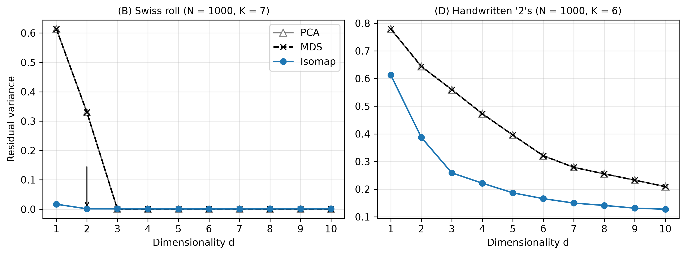

# Reproducing Isomap (Tenenbaum, de Silva & Langford, Science 2000)

This repository contains a from-scratch Python implementation of the **Isomap**
algorithm and a reproduction of the main experiment of the paper:

> J. B. Tenenbaum, V. de Silva, J. C. Langford.
> *A Global Geometric Framework for Nonlinear Dimensionality Reduction.*
> Science 290(5500), 2319–2323, 2000.

## What the code does

The notebook `isomap.ipynb` implements the three steps of Isomap (Table 1 of the paper):

1. **Neighborhood graph**: connect each point to its K nearest neighbors.
2. **Geodesic distances**: shortest paths in the graph (Dijkstra's algorithm).
3. **Embedding**: classical MDS on the graph distances.

It then reproduces the **residual-variance experiment of Fig. 2** of the paper,
comparing Isomap with PCA and classical MDS on two datasets:

- **Fig. 2B**: Swiss roll, N = 1000 points, K = 7
- **Fig. 2D**: 1000 handwritten "2"s from MNIST, K = 6

The implementation is verified against `sklearn.manifold.Isomap`
(identical graph distances and embeddings).

## Results



- **Swiss roll:** Isomap's residual variance drops to ~0 at d = 2 (the true
  dimensionality), while PCA and MDS only reach 0 at d = 3. This agrees with Fig. 2B.
- **Handwritten "2"s:** Isomap has lower residual variance than PCA/MDS for every d,
  with no clear elbow, as in Fig. 2D.

### Differences from the paper

- For the digits, the paper uses **tangent distance** and **ε-Isomap (ε = 4.2)**.
  We use **Euclidean distance** and **K-Isomap (K = 6)**, because with Euclidean
  distances the ε-graph is split into many disconnected components.
- The paper does not report which 1000 digits or which random Swiss roll sample was used;
  we fix `random_state = 0`.
- Panels 2A (faces) and 2C (hands) are not reproduced.

## How to run

```bash
pip install -r requirements.txt
jupyter notebook isomap.ipynb
```

Alternatively, open `isomap.ipynb` in VS Code (with the Python and Jupyter
extensions) and select **Run All**.

The MNIST data are downloaded automatically from OpenML on the first run
(about 1 minute).

The notebook was developed and run locally (Windows, VS Code).

## Environment

Python 3.14.7, numpy 2.5.3, scipy 1.18.1, scikit-learn 1.9.1,
matplotlib 3.11.2, pandas 3.0.6.

## Files

| File | Description |
|---|---|
| `isomap.ipynb` | Implementation and experiments |
| `requirements.txt` | Required Python libraries |
| `fig2_reproduced.png` | Reproduced Fig. 2B and 2D (used in the report) |
| `fig2B_swiss_roll.png` | Swiss roll residual variance |
| `fig2D_digits.png` | Handwritten "2"s residual variance |
